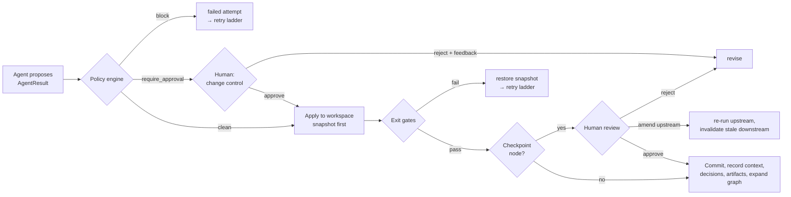
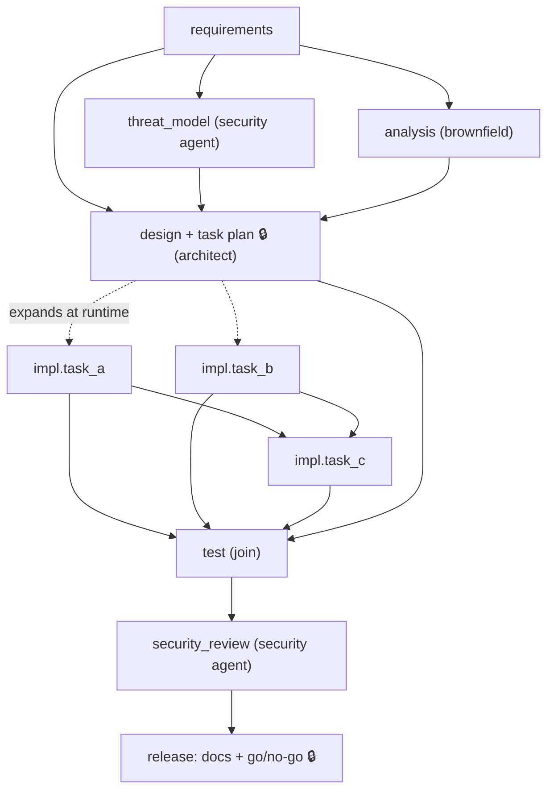
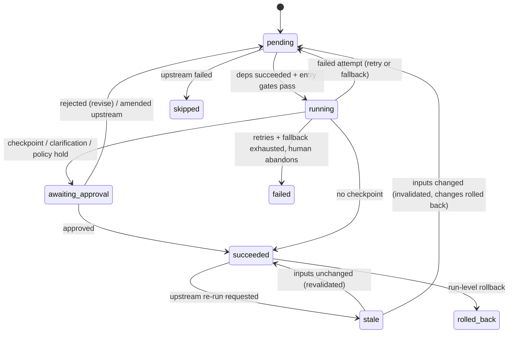

# Architecture

## 0. Two languages on purpose

The orchestrator is Python; the product it builds is a C# / .NET 10 service. That is a common
enterprise split: the agent layer lives where the AI tooling is most mature, and works on code in
whatever stack the team ships. Nothing in the engine, graph, approvals or audit log depends on
the product's language. The language-specific parts are isolated:

| Concern | Where | .NET implementation |
|---|---|---|
| Build and test | `workspace.py` (`toolchain` per scenario) | `dotnet build`, `dotnet test --logger trx`; TRX results mapped to `tests/<Project>/<Class>.cs::<Method>` ids |
| Language guardrails | `policy.py` | `Process.Start`, `BinaryFormatter`, disabled TLS validation, interpolated SQL, PII in logs; new NuGet `PackageReference`s; append-only `Migrations.cs` |
| Codebase analysis | `agents/analyst.py` | lexical C# indexer: types, methods, `app.Map*` routes, type-reference dependency graph |
| Domain content | `playbooks/` | C# reference code and targeted edits |

Pointing the orchestrator at Java or another stack means adding a toolchain to `workspace.py`,
rules to `policy.py`, and an indexer to the analyst.

## 1. Principle: agents propose, the engine disposes

Agents never touch the filesystem, run state, git, or approvals. Each agent receives a read-only
context (upstream outputs, a read view of the workspace, reviewer feedback, previous errors) and
returns a structured `AgentResult`: an output document, proposed file changes, decisions with
rationale, optional clarification questions, and optionally new graph nodes. The engine decides
what happens to that proposal:

This is the controlled-autonomy boundary: an agent can be wrong, slow, malicious-by-injection or
unavailable, and the worst outcome is a failed attempt that leaves no trace in the workspace.

## 2. Components

| Component | File | Responsibility |
|---|---|---|
| Workflow graph | `graph.py` | Nodes, explicit dependencies, topological order, cycle detection, detection of parallel nodes with overlapping write scopes, Mermaid export |
| Run state | `state.py` | Node status/attempts/revisions, outputs and their fingerprints, input fingerprints, applied snapshots, decision lineage, approvals, findings; atomic JSON persistence for resume |
| Engine | `engine.py` | Scheduler, worker pool, outcome handling, retry → fallback → human escalation, change-control holds, checkpoints, amendments, invalidation, dynamic expansion, safe stop, run-level rollback |
| Workspace | `workspace.py` | Git-backed sandbox: path confinement, composable edits with exact-once anchors, snapshot/restore, per-node commits, `dotnet build`/`dotnet test` runner with TRX parsing (pytest for Python targets) |
| Policy | `policy.py`, `policies.json` | Guardrails on every change set before it is applied (Section 6) |
| Gates | `gates.py` | Entry gates (preconditions) and exit gates (independent verification) |
| Approvals | `approvals.py` | Checkpoint requests and decisions; CLI, auto (unattended) and scripted approvers |
| Audit | `audit.py` | Append-only, SHA-256 hash-chained JSONL with a verifier |
| Metrics | `metrics.py` | Success and first-pass rate, retries, fallbacks, rollbacks, invalidations, MTTR, end-to-end and agent latency, tokens |
| LLM | `llm.py` | Anthropic provider over stdlib HTTP (others plug in via `LLMProvider`); per-run call/token budget; JSON extraction; untrusted-content quoting |
| Agents | `agents/` | Seven: requirements, codebase analyst, security (threat model before design, review after tests), architect (design + task plan), implementer, tester, release (docs + go/no-go) |
| Playbooks | `playbooks/` | Offline domain content per scenario (requirements, ADRs, tasks, code) |
| Reports | `report.py` | `report.md` and `ENGINEERING_SUMMARY.md` from state and audit |

## 3. Orchestration model

### 3.1 The SDLC graph

- **Sequential and parallel paths.** Any node whose dependencies have all succeeded and whose
  entry gates pass is scheduled, up to `--max-parallel` at once. `threat_model ∥ analysis` and
  independent implementation tasks run concurrently.
- **Synchronization.** A node with several dependencies is a join: `design` waits for the threat
  model and the analysis; `test` waits for every implementation task the architect created;
  `release` waits for review and docs.
- **Dynamic graph.** The architect returns tasks with dependencies and file ownership; the engine
  inserts them as `impl.<task>` nodes and wires them into the `test` join. Before accepting the
  expansion, it validates the new graph: no cycles, and no two nodes that could run concurrently
  may declare overlapping write scopes. An invalid plan fails the design node instead of
  corrupting the run.

### 3.2 Node lifecycle

### 3.3 Threading model

The main thread owns all state transitions and every human interaction; worker threads only run
a single attempt (agent → policy → apply → exit gates) and return an `Outcome`. This keeps run
state free of locking concerns. The workspace serializes git operations and file writes with its
own locks; parallel nodes write disjoint files by construction (scope validation above).
Builds and test runs are serialized with a tool lock, because concurrent `dotnet build`s in one
source tree clash on `obj/` and `bin/`. Parallel tasks therefore overlap in agent work (LLM calls,
planning, edits) but take turns compiling. A side effect worth knowing: compilation is
project-wide, so a broken change from one task can fail a parallel task's build; that task simply
retries after the broken change is rolled back.

### 3.4 Cross-stage context and decision lineage

- Every node sees the outputs of all its transitive ancestors (`RunState.upstream_outputs`), so
  the implementer sees the approved design and the architect sees the analysis and threat model.
- Each output is fingerprinted (SHA-256 of canonical JSON). Each node records the fingerprints of
  the inputs it consumed.
- Every agent decision and every human decision is recorded with the IDs of the active upstream
  decisions it builds on (`parents`). A re-run supersedes the node's earlier agent decisions. The
  report renders the full lineage, so "why does the rate limiter exist?" can be traced from the
  release decision back through the task plan, the ADR, the clarification answer and the original
  requirement.

### 3.5 Re-planning when upstream outputs change

When a reviewer amends an upstream node (for example, rejecting the design with
`amend_node: requirements`):

1. The target node's own workspace changes are restored; it is reset to `pending` with the
   amendment as feedback.
2. Every descendant is marked `stale`. Stale nodes are never scheduled, and a stale node that is
   currently running has its result discarded when it returns.
3. When the target succeeds again, descendants are settled in topological order: a node whose
   input fingerprints are unchanged is **revalidated** without re-running; a node whose inputs
   changed is **invalidated**: its applied changes are restored (in reverse topological order, so
   later edits are undone first), and it returns to `pending`.
4. If the architect's task plan changes, its previous dynamic nodes are removed and replaced
   (`graph_replan` in the audit log); if unchanged, executed tasks remain valid.

The ambiguous scenario exercises this end to end.

## 4. Failure handling ladder

| Step | Trigger | Behaviour |
|---|---|---|
| Retry | Agent error, policy block, exit-gate failure | Up to `max_attempts` per node (default 3) with bounded exponential backoff. The next attempt receives the previous error text, so an LLM agent can correct itself. |
| Rollback (attempt) | Exit gate fails after changes were applied | Snapshot restored before the retry; the workspace never holds a half-validated change. |
| Agent-level fallback | LLM error or invalid structured output | The agent falls back to its deterministic playbook within the same attempt (`provider_fallbacks`). |
| Node-level fallback | Retries exhausted | Switch to the node's `fallback_agent` (default `<agent>:offline`, the same role forced onto the deterministic path) with a fresh retry budget. |
| Human escalation | Fallback exhausted | Checkpoint `failure_escalation`: retry with guidance (bounded by `max_revisions`), abandon (downstream is skipped, independent branches continue), or stop. Unattended runs always stop here. |
| Safe stop | Reviewer stop, `STOP` file / `agentic stop`, SIGINT, LLM budget exhausted | No new nodes start; in-flight attempts finish and are handled; results that would need a human are rolled back and left `pending`. State is saved; `agentic resume` continues. `--rollback-on-stop` also resets the workspace to baseline. |
| Run rollback | `agentic rollback <run> --to baseline\|<node>` | `git reset --hard` to the checkpoint; nodes after it are marked `rolled_back`; audited. |

Revisions requested by reviewers are bounded too (`max_revisions`, default 3), so a
disagreement between a human and an agent cannot loop forever.

## 5. Gates

| Gate | Kind | Used by | Check |
|---|---|---|---|
| `design_approved` | entry | every `impl.*` | the design and task plan were approved by a human |
| `tests_green` | entry | security review, release | the last full-suite gate passed |
| `review_passed` | entry | release | security review status is pass |
| `compiles` | exit | `impl.*` | `dotnet build` of the whole solution succeeds (Python targets: each changed file compiles) |
| `task_tests` | exit | `impl.*` | the task's own test classes pass (`dotnet test --filter`, results parsed from TRX) |
| `full_suite` | exit | test | entire `dotnet test` suite passes and meets `min_tests` |
| `review_clean` | exit | security review | no blocking findings, every high-impact risk verified by a passing test |
| `docs_complete` | exit | release | README has required sections; implemented routes match `openapi.yaml` |
| `release_ready` | exit | release | every readiness checklist item passes |

Gates never trust an agent's claims: test gates run the tests themselves, the security reviewer
re-scans the full diff independently of per-node checks, and the docs gate compares code against
the spec.

## 6. Guardrails (policy engine)

Evaluated on the **final content** of every proposed change set, before anything is written.
Only lines the change introduces are judged, so legacy code does not block unrelated work.

| Area | Rule | Severity |
|---|---|---|
| Change scope | path escapes workspace; protected paths (`.git`, `.github`, keys, `.env`); writing outside the node's declared scope | block |
| Secrets | AWS keys, private keys, hard-coded credentials | block |
| Security | `eval`/`exec`, `os.system`, `shell=True`, `pickle.load(s)`, unsafe `yaml.load`, `verify=False`, SQL built with f-strings/format (production code; tests exempt) | block |
| Compliance | logging client IPs, credentials or auth headers | block |
| Quality | syntax errors | block |
| Supply chain | new dependency not on the allow-list | require approval |
| Supply chain | dependency on the deny-list | block |
| Change control | new schema migration | require approval |
| Change control | editing an already-applied migration | block |
| Change control | deleting a test file; brownfield change over 400 lines | require approval |

Thresholds and lists live in `agentic/policies.json`; scenarios can override them.

**Prompt injection.** Workspace files and prior outputs sent to a model are wrapped as quoted
data with an instruction to ignore embedded instructions. Model output is never executed: it is
parsed into a schema-validated structure, scope-checked and policy-checked like any other
proposal, and only then applied and tested.

## 7. Observability and audit

- `audit.jsonl`: every transition (node status, attempt failures, retries, fallbacks, rollbacks,
  policy findings, gate results, approvals requested and decided, decisions, graph expansion and
  replans, invalidations, artifacts, safe stops). Each record contains the hash of the previous
  one; `agentic verify-audit` detects any modification, deletion or reordering.
- Workspace git history: one commit per successful node (`[impl.http_api] ...`), plus explicit
  `[rollback]` commits, giving a reviewable change history per stage.
- `metrics.json` per run and `agentic metrics` across runs: success rate, first-pass rate,
  attempts, retries, fallbacks, provider fallbacks, rollbacks, invalidations, replans, policy
  blocks, approvals requested/rejected, MTTR (first failure → recovery per node), end-to-end
  latency and agent time (end-to-end minus human wait), per-node latency, LLM tokens.

## 8. Key decisions and trade-offs

| Decision | Why | Trade-off accepted |
|---|---|---|
| Explicit DAG with dynamic expansion instead of an agent-driven loop | Dependencies, gates and checkpoints are inspectable before anything runs; the architect's freedom is bounded to adding validated nodes | Less open-ended than a free-form agent loop |
| Engine applies changes, agents only propose | Policy, scope and rollback are enforced in one place, independent of agent quality | Agents cannot run arbitrary tools; tool access is engine-mediated |
| Git-backed workspace + per-attempt snapshots | Precise rollback of one node while others run; reviewable history; run-level reset | Requires git; snapshot granularity is per file |
| Threads + main-thread state ownership | Simple concurrency model; humans interact on one thread | Python threads give I/O concurrency (LLM calls, subprocess tests), not CPU parallelism; adequate here |
| File-based state (JSON + JSONL) | Zero infrastructure; resumable; diffable | Single orchestrator process per run; no multi-host coordination |
| Deterministic reviewer, docs and release agents | The model that wrote the code should not be the one certifying it | Less nuanced review than an LLM reviewer; can be added as an advisory layer |
| Scripted approvals for demos | Reproducible runs and CI | Scripts must be kept in sync with scenarios; interactive mode is the real thing |
| Offline playbooks | Runs anywhere with no API key; makes the orchestration itself testable | Offline implementation replays curated code (the orchestration, validation and governance are real; the "creativity" is not) |
